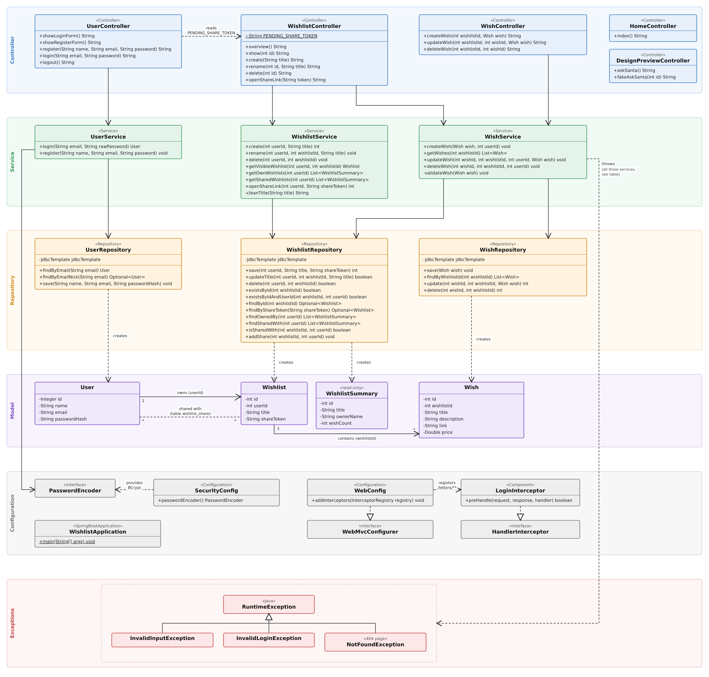

# Class diagram

The class diagram is the final documentation of the program design. It shows every class in `dk.ek.wishlist`, one layer per row.

Open [class-diagram.svg](class-diagram.svg) to zoom without losing sharpness.

## How to read it

Calls go **down**, one layer at a time: **Controller → Service → Repository → database**. The model classes are what the layers pass between them.

| Symbol | Meaning |
|---|---|
| Solid arrow | "has and uses": a controller has a service, a service has a repository |
| Dashed arrow | "depends on": creates an object, reads a constant, or throws an exception |
| Hollow triangle | "extends" (solid) or "implements" (dashed) |
| `+` `-` `~` | public, private, package-private. Underlined means static. |
| `1`, `*` | how many: one user owns many wishlists, one wishlist contains many wishes |

**Layers**
- **Controller**: reads the request and picks the next page. No rules.
- **Service**: validation and access rules (who may see or change what). Throws exceptions.
- **Repository**: the only classes that talk to the database, through `JdbcTemplate`.
- **Model**: plain data objects. `WishlistSummary` is read-only and is built from one SQL query for the overview page.

**Model relations.** `User`, `Wishlist` and `Wish` are connected by **ids** (`Wishlist.userId`, `Wish.wishlistId`), not by object references. The many-to-many "shared with" link has no Java class. It is the table `wishlist_share` (see [database.md](database.md)), handled by `WishlistRepository.isSharedWith` and `addShare`.

**Configuration.** `WebConfig` registers `LoginInterceptor` on `/letters` and `/letters/**`, so a user who is not logged in is sent to the login page. `SecurityConfig` provides the BCrypt `PasswordEncoder` that `UserService` uses to hash and check passwords.

## Which service throws which exception

The diagram has one "throws" arrow from the services to the exceptions, to keep it readable. The details are here:

| Service | `InvalidInputException` | `InvalidLoginException` | `NotFoundException` |
|---|---|---|---|
| `UserService` | `register` (name, e-mail, password rules, e-mail taken) | `login` (wrong e-mail or password) | |
| `WishlistService` | `create`, `rename` (title missing or too long) | | `rename`, `delete`, `getVisibleWishlist`, `openShareLink` |
| `WishService` | `createWish`, `updateWish` (title, price) | | `createWish`, `updateWish`, `deleteWish` |

The controllers catch `InvalidInputException` and `InvalidLoginException` and show the message on the same page. `NotFoundException` is either caught by `WishController` (redirect to the overview) or shown as the 404 page.

## Left out to keep it readable

- Constructors, getters and setters
- Spring parameters such as `Model`, `HttpSession`, `RedirectAttributes`, `BindingResult` and the logged-in `userId`
- Private SQL constants and row mappers in the repositories
- Arrows from services and controllers to the model classes they pass around

## Web routes

The diagram shows methods, not URLs. This table connects them.

| Method | Route | Controller method |
|---|---|---|
| GET | `/` | `HomeController.index` (redirects to `/letters`) |
| GET | `/login` | `UserController.showLoginForm` |
| POST | `/login` | `UserController.login` |
| GET | `/register` | `UserController.showRegisterForm` |
| POST | `/register` | `UserController.register` |
| POST | `/logout` | `UserController.logout` |
| GET | `/letters` | `WishlistController.overview` (protected by `LoginInterceptor`) |
| GET | `/wishlists/{id}` | `WishlistController.show` |
| POST | `/wishlists` | `WishlistController.create` |
| POST | `/wishlists/{id}/title` | `WishlistController.rename` |
| POST | `/wishlists/{id}/delete` | `WishlistController.delete` |
| GET | `/s/{token}` | `WishlistController.openShareLink` |
| POST | `/wishlists/{wishlistId}/wishes` | `WishController.createWish` |
| POST | `/wishlists/{wishlistId}/wishes/{wishId}/update` | `WishController.updateWish` |
| POST | `/wishlists/{wishlistId}/wishes/{wishId}/delete` | `WishController.deleteWish` |
| GET, POST | `/letters/{id}/santa` | `DesignPreviewController.askSanta`, `fakeAskSanta` |

## Changing the diagram

The SVG is drawn by hand, not generated from the code. It is plain text, so it can be edited in any text editor, or imported into [diagrams.net](https://app.diagrams.net) (File → Import from → Device). When the code changes, update the SVG and export a new PNG.
