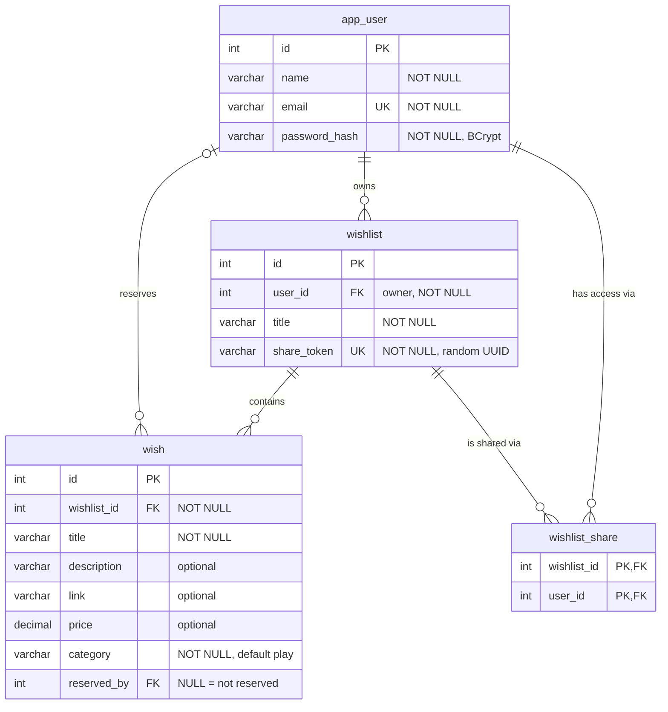

# Database

The Santa Claude database has four tables:

| Table | Holds |
|---|---|
| `app_user` | Accounts |
| `wishlist` | The wishlists (ønskesedler) |
| `wish` | The wishes on a list, including who has reserved each one |
| `wishlist_share` | Who has access to a list that was shared with them |

The same tables are created in `schema.sql` (MySQL) and `h2init.sql` (H2, used by the tests).

## ER diagram



**How to read the diagram:**
- A **user** owns zero or more **wishlists**.
- A **wishlist** contains zero or more **wishes**.
- A **wish** is reserved by at most one user (`reserved_by`, empty when free).
- **`wishlist_share`** is a link table: one row means "this user has access to this list". A user can have many shared lists, and a list can be shared with many users.

## Schema

```sql
CREATE TABLE app_user (
    id            INT AUTO_INCREMENT PRIMARY KEY,
    name          VARCHAR(100) NOT NULL,
    email         VARCHAR(255) NOT NULL UNIQUE,
    password_hash VARCHAR(100) NOT NULL
);

CREATE TABLE wishlist (
    id          INT AUTO_INCREMENT PRIMARY KEY,
    user_id     INT          NOT NULL,          -- the owner
    title       VARCHAR(100) NOT NULL,
    share_token VARCHAR(36)  NOT NULL UNIQUE,   -- secret part of the share link
    FOREIGN KEY (user_id) REFERENCES app_user(id) ON DELETE CASCADE
);

CREATE TABLE wish (
    id          INT AUTO_INCREMENT PRIMARY KEY,
    wishlist_id INT           NOT NULL,
    title       VARCHAR(150)  NOT NULL,
    description VARCHAR(500)  NULL,
    link        VARCHAR(500)  NULL,
    price       DECIMAL(10,2) NULL,
    category    VARCHAR(10)   NOT NULL DEFAULT 'play',   -- tech, book, wear, home, play
    reserved_by INT           NULL,                      -- NULL = not reserved
    FOREIGN KEY (wishlist_id) REFERENCES wishlist(id) ON DELETE CASCADE,
    FOREIGN KEY (reserved_by) REFERENCES app_user(id) ON DELETE SET NULL
);

CREATE TABLE wishlist_share (
    wishlist_id INT NOT NULL,
    user_id     INT NOT NULL,
    PRIMARY KEY (wishlist_id, user_id),
    FOREIGN KEY (wishlist_id) REFERENCES wishlist(id) ON DELETE CASCADE,
    FOREIGN KEY (user_id) REFERENCES app_user(id) ON DELETE CASCADE
);
```

Create the tables in this order: a table must exist before another one can refer to it.

## Tables

### `app_user`

| Column | Type | Notes |
|---|---|---|
| `id` | INT | Primary key |
| `name` | VARCHAR(100) | Shown on the user's lists, e.g. "Patrick Clemmensen" |
| `email` | VARCHAR(255) | Used to log in. `UNIQUE`: two accounts can't share an e-mail. |
| `password_hash` | VARCHAR(100) | BCrypt hash. The password itself is never stored. |

Called `app_user` because `user` is a reserved word in H2 and some other databases.

### `wishlist`

| Column | Type | Notes |
|---|---|---|
| `id` | INT | Primary key |
| `user_id` | INT | The owner → `app_user.id` |
| `title` | VARCHAR(100) | E.g. "Patricks ønskeseddel" |
| `share_token` | VARCHAR(36) | Random `UUID.randomUUID()`, created with the list. The share link is `/s/{share_token}`. `UNIQUE`. |

### `wish`

| Column | Type | Notes |
|---|---|---|
| `id` | INT | Primary key. Also gives the display order (`ORDER BY id`). |
| `wishlist_id` | INT | The list it belongs to → `wishlist.id` |
| `title` | VARCHAR(150) | Required |
| `description` | VARCHAR(500) | Optional: size, colour, anything the giver should know |
| `link` | VARCHAR(500) | Optional link to a shop. The app shows its domain ("proshop.dk"). |
| `price` | DECIMAL(10,2) | Optional. `DECIMAL`, not `DOUBLE`, so amounts are exact. |
| `category` | VARCHAR(10) | One of `tech`, `book`, `wear`, `home`, `play`; picks the card's colour and icon |
| `reserved_by` | INT | Who reserved it → `app_user.id`. `NULL` = free. |

### `wishlist_share`

| Column | Type | Notes |
|---|---|---|
| `wishlist_id` | INT | → `wishlist.id` |
| `user_id` | INT | → `app_user.id` |

The primary key is the pair, so the same person can't be added to the same list twice. A row is added when a logged-in user opens a share link. The list then appears under "Delt med dig", and the user may view it and reserve wishes.

## Design decisions

**Reservation is a column, not a table.** A wish can only be reserved by one person, so a nullable `reserved_by` column is enough:

```sql
-- Reserve: only works if nobody has reserved it yet
UPDATE wish SET reserved_by = ? WHERE id = ? AND reserved_by IS NULL;

-- Cancel: only your own reservation
UPDATE wish SET reserved_by = NULL WHERE id = ? AND reserved_by = ?;
```

If the reserve `UPDATE` changes 0 rows, someone else got there first. The database decides this in one statement, so two people can't reserve the same wish at the same time.

**The owner never sees reservations.** `reserved_by` is stored, but the service never passes it on when the owner views their own list, so the surprise holds.

**What happens on delete:**

| You delete | Also deleted or changed |
|---|---|
| A user | Their wishlists, the wishes on them, and their shares (`CASCADE`). Their reservations on other people's wishes are released (`SET NULL`). |
| A wishlist | Its wishes and shares (`CASCADE`) |
| A wish | Nothing else: its reservation is part of the row |

**Access rules** (enforced in the services, not by the database):

| Who | Can |
|---|---|
| The owner (`wishlist.user_id`) | View, add, edit and delete wishes, rename and delete the list |
| A user with a row in `wishlist_share` | View the list, reserve free wishes, cancel their own reservation |
| Anyone else | Nothing. Opening `/wishlists/{id}` directly gives 403 Forbidden. |
